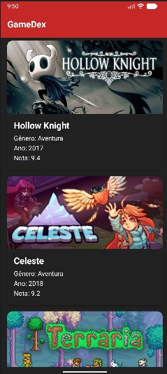
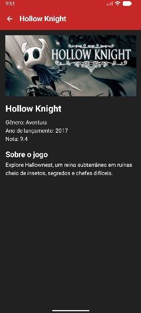

# GameDex – Catálogo de Jogos

# Integrantes
- Otávio Brocca Caporal

# Tema
Aplicativo GameDex, que mostra um catálogo de jogos. Desenvolvido em Kotlin utilizando Jetpack Compose.

O GameDex permite visualizar uma lista de jogos e acessar uma tela de detalhes com informações, imagem e descrição de cada jogo.

# Prints do aplicativo

# Tela principal – Catálogo

# Tela de detalhes
